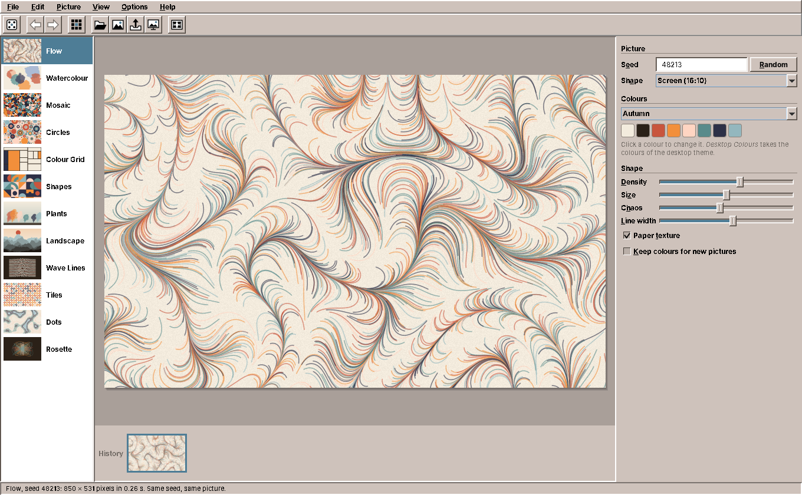

# amade-artstudio

**amade-artstudio** is the generative art studio of the [amadeOS](https://github.com/amadeos-eu/amadeos) desktop. Pick a style and colours, move a few sliders and let chance do the rest. Every picture is drawn on this computer, without internet, from a short recipe: the same recipe always gives the same picture, at any size. Built like the other amadeOS applications.




## Features

- **Twelve styles**:
  - *Flow*: lines that follow the angle of a noise field, like hair or wood grain
  - *Watercolour*: translucent washes with soft, frayed edges
  - *Mosaic*: stones of irregular shape with grout between them, slightly darker towards their edges
  - *Circles*: circles packed as tightly as chance allows, the large ones with rings
  - *Colour Grid*: the picture split again and again into rectangles with thick lines, some fields coloured
  - *Shapes*: square tiles, each with a quarter or half circle, a dot, a triangle or bars
  - *Plants*: trees and shrubs grown from an L-system on a meadow
  - *Landscape*: mountain ridges, hazier towards the back, with a sun or a moon
  - *Wave Lines*: stacked lines on dark ground that swing out in the middle
  - *Tiles*: quarter arcs on turned tiles that join into winding paths
  - *Dots*: dots whose density and colour follow noise
  - *Rosette*: damped oscillations in two directions, like a pendulum with a pen
- **The recipe**: style, seed (0 to 999 999 999), palette, four sliders (*Density*, *Size*, *Chaos*, *Line width* or *Edges*), paper texture and shape (16:10, 16:9, square, paper portrait or landscape). It is shown on the right and can be changed at any time.
- **Colours**: six palettes, *Desktop Colours* from the amadeOS colour theme (they follow it when the theme changes), or colours of your own: click a colour to change it. *Keep colours for new pictures* keeps them while trying new seeds.
- **New picture** (Ctrl+N, the die on the toolbar): a new seed and, unless the colours are kept, other colours. *Random Seed* (Ctrl+R) changes only the seed.
- **Variations** (Ctrl+G): nine close relatives of the picture in a grid, the picture in the middle. Click one to continue from it.
- **History** of the last forty pictures below the picture; *Back* and *Forward* (Alt+Left/Right, Ctrl+Z/Ctrl+Y).
- **Set as Backdrop** (Ctrl+B): draws the picture at the size of the screen and makes it the backdrop of the current workspace; the other workspaces keep theirs.
- **Files**:
  - *Save Picture* stores the picture as shown, as PNG with the recipe inside. Opening such a PNG brings back the recipe.
  - *Export Picture* draws the picture at any size up to 12 000 pixels a side: the screen, Full HD, QHD, 4K, A4 to A2 at 300 dpi, or your own. The composition stays the same at every size.
  - *Save Recipe* writes a small text file (`.artrecipe`). *Copy Recipe* puts it on the clipboard as one line, to share it in a mail; *Paste Recipe* reads it back.
  - A recipe or PNG given on the command line is opened.
- Full screen (F11): only the picture.
- Drawing runs in the background, so the window stays responsive; the nine variations and the small pictures of the styles are drawn on all processor cores at once. A new change cancels the picture that is no longer wanted.
- Five languages (English, Deutsch, Français, Español, Italiano), following the amadeOS desktop language; *Options → Language* overrides it.
- Theme colours, Motif look and 3D toolbar buttons from [amade-commons](https://github.com/amadeos-eu/amade-commons). The toolbar icons are drawn in Java2D, so no icon theme is needed.

## Architecture

Java 25, Swing and Guice, built like [amade-fractals](https://github.com/amadeos-eu/amade-fractals). Theme, language and start-up come from `AmadeApplication` in amade-commons. Packages, key decisions and flows are described in [ARCHITECTURE.md](ARCHITECTURE.md).

## Build and run

```sh
./gradlew run                              # start
./gradlew run --args=sea.artrecipe         # open a recipe or a PNG saved by Art Studio
./gradlew test                             # Swing tests need a display: xvfb-run ./gradlew test
./gradlew deb                              # build/distributions/amade-artstudio_<version>_all.deb
./gradlew installToAmadeOs                 # the .deb into ../amadeos/config/packages.chroot/ for the ISO build
./gradlew windowsInstaller                 # on Windows: MSI with its own Java runtime (needs WiX Toolset 3)
./gradlew windowsInstaller -PinstallerType=app-image   # portable folder with amade-artstudio.exe
```

If `../amade-commons` is checked out next to this repository, Gradle builds against that checkout instead of the JitPack version.

## Planned

- SVG export of the line styles, for plotters and cutting machines
- Slowly moving pictures as a screen saver
- Text to picture with a local AI model, as an optional package (`amade-artstudio-ai`)

## Background

Noise fields, L-systems, circle packing, recursive subdivision and the other techniques are long-known methods of generative art. The code here is written for amadeOS from scratch; no pictures or models are included or downloaded.

## Licence

EUPL-1.2, see [LICENSE](LICENSE).
